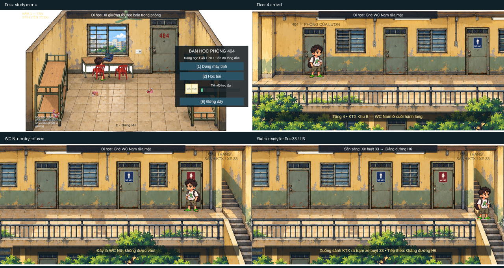

# Room 404 → Floor 4 dorm journey

## Delivered behavior

- Sitting on either red chair opens DeskActionModal. Key/button 1 uses the
  computer (laptop light + looping keyboard foley); key/button 2 shows an open-book
  UI icon and increases the study bar. E or the stand-up button exits through the
  existing chair component, closes the modal and stops sound. Story modals have
  priority. Physical interaction remains outside MVPFlowController.
- Claim the original bed as in the existing story, then E near the original
  backpack equips it once. The placed sprite disappears while its story object
  remains intact. Idle/walk use the new backpack poses; standing after a chair,
  bed or transition restores the equipped appearance.
- Open Room_Door with E and walk through its threshold. Wearing the backpack
  enables a short fade into Hallway_Zone. Camera follows the player along the
  balcony corridor; wall/railing/end colliders define the walking strip. The 404
  doorway returns to the original room camera and arrival marker. Holding W
  through the outward transition cannot bounce the player straight back.
- E at WC Nam locks input/physics, fades for a 1.5-second fast resolve with
  running-water foley, then automatically returns to its ExitPivot and sets
  HasRefreshed. WC Nu shows the warning and keeps the player outside/unlocked.
- E at the stairs requires both backpack and refreshed flags, then sets
  ReadyForBus and shows the bus 33 / H6 handoff message. The next travel zones
  (ground-floor lobby, bus stop and H6) are future work beyond this goal.

## Files created

Runtime scripts under `mobile-2d/Assets/Scripts/`:
`DormJourneyController.cs`, `DeskActionModal.cs`, `BackpackInteractable.cs`,
`RestroomInteractable.cs`, `DormDoorwayTrigger.cs`, `DormStairsInteractable.cs`,
`DormSound.cs` (+ Unity metadata).

Integration: `mobile-2d/Assets/Editor/DormJourneySceneSetup.cs` (+ metadata).
Native foreground: `mobile-2d/Assets/Room404Layout/HallwayRailing.asset` (+ metadata).
Art: seven PNGs + import metadata under `mobile-2d/Assets/Sprites/MVP/dorm_journey/`.
Batch sources, prompts, slicing manifest/scripts and review captures under
`assets/mvp_sprites/dorm_journey/`.

## Files modified for this goal

- `ChairInteractable.cs`: optional menu reference, open/close hooks.
- `LuonCharacterVisual.cs`: optional equipped idle/walk sprites; pose system reused.
- `RoomInteractionSceneSetup.cs`: invoke the idempotent journey integration;
  defer one-shot setup until Edit Mode rather than throwing during Play Mode.
- `MVPSceneSnapshot.cs`: optional overlay UI capture at the current camera aspect.
- `PlayModeInteractionSuite.cs`: real input journey/UI coverage and temporary
  background input properties, restored after testing without replacing settings.
- `Room404_MVP.unity`: references and additional zone/UI/colliders.
- Test reports and handover documentation.
- LiberationSans SDF fallback atlas: Unity generated the glyph cache/material
  pages needed by the new Vietnamese UI and world labels.

Existing MVPFlowController story progression, player movement, generic detector,
IInteractable contract, door swing system, room layout and bed behavior are reused.
Earlier Bed/Chair/Door work remains described in ROOM404_VISUAL_REVIEW.md.

## Scene / Inspector

Dorm_Journey owns the local mission flags and shared transition lock/fade/audio.
Hallway_Zone contains the corridor, Balcony_Foreground, four boundaries,
Room404_ExitPivot, Room404_ReturnTrigger, WC_Nam/WC_Nu with ExitPivots,
Stairs_Trigger and world labels. Room_Door adds DoorwayTrigger alongside its
existing physical/interaction colliders. Canvas_DormJourney contains the HUD,
notice, desk modal and fade. The original Backpack_Prop gains an interaction
component/trigger. All references are assigned by the shared setup; rebuilding
through the sole KTX404/Build Room 404 Scene menu retains integration.

## Asset generation

One planned 3x3 batch: continuous wide corridor on the top row; WC Nam, WC Nu,
backpack idle on row 2; three walking poses on row 3. One whole-sheet alpha/cycle
refinement, no separate per-sprite generation. Exact prompts and crop/import
metadata: [generation notes](assets/mvp_sprites/dorm_journey/GENERATION.md).
PPU 100, Point, Uncompressed; seven distinct runtime files. Balcony foreground
uses a native rect on the same texture. Existing backpack prop/furniture are
reused. Books are native UI shapes; audio is original procedural foley.

## Validation

Unity 6000.6.7f1 compiled successfully. Final Play Mode result: **116/116 passed, 0 errors**, completed UTC **2026-10-25T05:19:51.4455670Z**.

Final result is recorded in `mobile-2d/PlayModeInteractionReports/report.json`
and `story-report.json`. Tests cover keyboard E/1/2, stand button binding,
computer light/audio, study progress, backpack pickup, actual physical doorway
crossing, held-W protection, free corridor walking/camera follow, female refusal,
male fade/water/exit/unlock, stairs prerequisites/readiness, room return and all
four story stages plus ending. Runtime Error/Exception/Assert is collected.

Native UI review additionally clicked Computer, Study and Stand with a mouse:
all three changed the actual Game View correctly; Console had zero errors.
The final QA also re-enters Play Mode after the suite to verify input cleanup.

## Reviews

