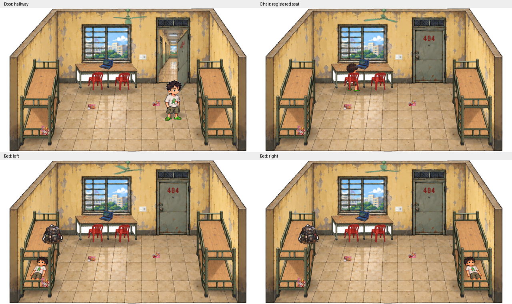

# DONE — Room 404 Bed / Chair / Door

## Files created

- `assets/mvp_sprites/room_visual_v2/`: source sheet, alpha sheet, exact `PROMPT.md`,
  `GENERATION.md`, `manifest.json`, reproducible `slice.py`, `build_review.py`,
  extracted contact sheet and curated review PNG/GIFs.
- `mobile-2d/Assets/Sprites/MVP/characters/room_visual_v2/`: sitting, enter_01..03,
  lying_a, lying_b, sleeping (seven PNGs + importer metadata).
- `mobile-2d/Assets/Sprites/MVP/environment/room_visual_v2/hallway.png` + metadata.
- `mobile-2d/Assets/Room404Layout/BedForegroundV2.asset`, `DeskForeground.asset`
  (+ metadata): native sprite crops of existing furniture, not newly generated art.
- `mobile-2d/PlayModeInteractionReports/story-report.json`.

## Files modified

- Runtime: `IInteractable.cs`, `PlayerInteractionStateController.cs`,
  `BedInteractable.cs`, `ChairInteractable.cs`, `LuonCharacterVisual.cs`,
  `HingedRoomDoor.cs` under `mobile-2d/Assets/Scripts/`.
- Editor: `RoomInteractionSceneSetup.cs`, `BedAnimationClipGenerator.cs`,
  `PlayModeInteractionSuite.cs`, `MVPSceneTester.cs`, `MVPSceneSnapshot.cs`.
- `Room404_MVP.unity` and the four bed animation clips.
- Test report, `.gitignore` (raw generated test PNGs), and `NEXT_STEPS_HANDOVER.md`.

## GameObjects / assigned references

- Room_Door: existing HingedRoomDoor + blocking BoxCollider2D;
  Doorway_Opening now references hallway, Door_Shadow SpriteRenderer added,
  Door_Interaction CircleCollider2D trigger added.
- Study_Desk: Desk_Foreground SpriteRenderer added; both ChairInteractables
  reference the existing desk back, new foreground, existing Seat/Exit markers.
- Both beds: existing Bed_Back, BedPivot, ExitPivot, Bed_Interaction,
  Bed_Foreground reused. Foreground sprite and pose transform updated.
- Player_Luon/Visual: all new pose sprites and arrays assigned. No competing
  Animator; LuonCharacterVisual is the sole runtime sprite animation writer.
- No manual assignments or missing assets remain.

## Assets generated & prompt

Built-in ImageGen, **one 4x2 batch** for all eight outputs, then one whole-sheet
alpha-extraction edit. No separate per-pose generation. The exact prompt is in
[the batch prompt](assets/mvp_sprites/room_visual_v2/PROMPT.md); slicing/import
metadata is in [the manifest](assets/mvp_sprites/room_visual_v2/manifest.json).
All runtime outputs: PPU 100, Point, Uncompressed, no mipmaps.

## Test result

Unity 6000.6.7f1: compile succeeded. Final real Play Mode suite **73/73 passed**,
**0 runtime errors/exceptions/asserts**, completed 2026-10-25 04:22:26 UTC.

Coverage: door dynamic prompt, E open/close, persistent detection while open,
projected shadow, walking through opening, close-sweep player protection; both
chairs and beds, authored markers, sprites, ownership, second-occupant rejection,
movement/physics locks, repeated E during transition, real enter/exit coroutines,
Sleeping, normal movement and presentation restoration. The story test observes
stages 1–4 plus ending through public events/UI without assigning stages.

[Interaction report](mobile-2d/PlayModeInteractionReports/report.json) ·
[Story report](mobile-2d/PlayModeInteractionReports/story-report.json)

## Visual review

Reviewed actual camera captures: the corridor is visible inside the original
frame; chair head is visible above its back with feet at floor level; lying head
points inward and feet toward the foreground; both bed poses mirror correctly;
foot rails occlude the lower body. Entry first pose braces toward the bed, then
turns/reclines while position interpolates continuously. Exit reverses it.

[Left bed motion](assets/mvp_sprites/room_visual_v2/review/bed-left-playmode.gif) ·
[Right bed motion](assets/mvp_sprites/room_visual_v2/review/bed-right-playmode.gif)

GIFs are presentation sequences assembled from actual Play Mode captures; their
viewing durations are chosen for review, not a frame-accurate gameplay recording.
